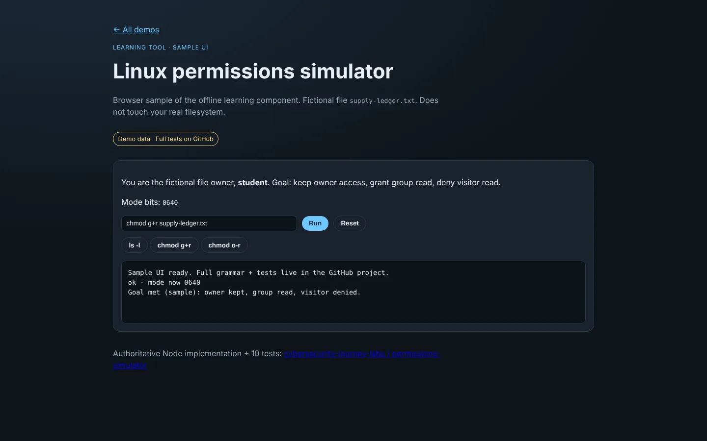
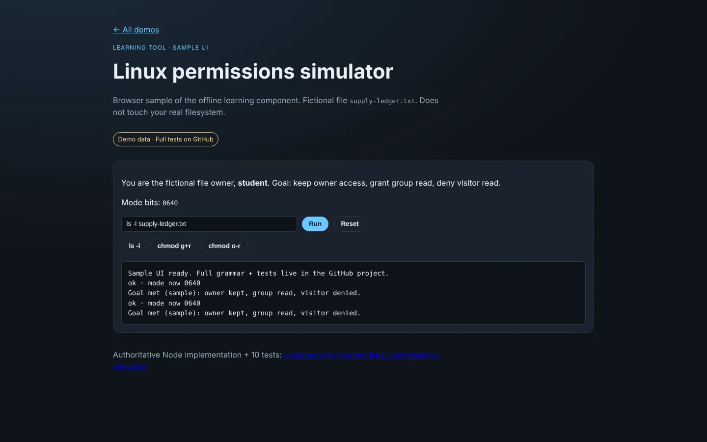

# Cybersecurity Journey — Labs

[](https://github.com/Beebopcat/cybersecurity-journey-labs/actions/workflows/tests.yml)

**Documented IT-support and security troubleshooting labs, plus a small Node.js permissions simulator with automated tests.**

**Why it matters:** this is the everyday work of IT support and entry-level SOC roles: reading Windows Event Logs with PowerShell, telling a real fault from noise, finding root cause by correlating timestamps, and sanitising evidence before it is published. The simulator adds least-privilege reasoning (file permissions) with strict input parsing and tests.

**Stack:** PowerShell 5.1, Windows Event Viewer and Windows Error Reporting, Node.js (ES modules, built-in `node:test`).

### Proof

- **10 passing automated tests** for the permissions simulator (`node --test`). I ran them on Windows 11 with Node.js 24 (10 of 10 passed); they have no dependencies, so any Node.js 22+ should run them. GitHub Actions runs them on every push.
- **Lab 01** is a full writeup of a real troubleshooting case: [Diagnosing an application failure from Windows Event Logs](labs/01-diagnosing-an-application-failure-from-event-logs/).
- **Labs 02 to 05** are written summaries of course work (two breach case studies, a signature-detection paper and the capstone incident report), written from public sources such as GAO, House Oversight and CISA. They are course analysis, not hands-on lab work.
- **Labs 06 and 07** are step-by-step home-lab plans (Windows log triage; Sysmon). They are planned and not yet performed.
- **Live browser demo** of the simulator's sample UI: [beebopcat.github.io/public-demos/permissions](https://beebopcat.github.io/public-demos/permissions/).
- Screenshots and a short clip are in [Media](#media-the-permissions-simulator-in-the-browser) below.

### Quick start

```sh
git clone https://github.com/Beebopcat/cybersecurity-journey-labs.git
cd cybersecurity-journey-labs/projects/permissions-simulator
node --test permission-simulator.test.mjs
```

Needs Node.js 22 or newer. No npm packages and no network access. Read Lab 01 by opening its README in `labs/`.

### Limitations

- One lab (01) is a hands-on writeup with a verified result. Labs 02 to 05 are course analysis; Labs 06 and 07 are plans with no results yet. CompTIA A+ is in progress; Network+, Security+, CySA+ and CCNA are planned, not earned.
- The simulator models only read/write/execute bits on one fictional file. It does not run a shell, touch a real filesystem or change real permissions.
- Lab evidence is sanitised, so raw logs, hostnames and exports are intentionally not included.
- The simulator code and tests were produced with AI assistance and then reviewed (details in its README).
- Labs 02 to 05 are rewritten summaries of my own coursework. Course slides, the capstone report and the course template are not republished, and AI tools were used for research and editing help, as disclosed in my course submissions. These writeups were drafted with AI assistance and reviewed by me.

---
Hands-on lab work and course analysis documented as I move from IT fundamentals toward a SOC analyst role.

Each entry carries one of three statuses, so you can tell what was done from what was studied or planned:

- **Lab:** hands-on work with a documented method and a verified result.
- **Course analysis:** a summary of my own coursework, written from public sources. Not hands-on, and the original course material is not republished.
- **Planned:** a step-by-step plan that has not been performed yet.

---

## Why this repo exists

Certificates prove you passed a test. This proves you can work a problem.

Each writeup shows the reasoning — including the wrong turns, because narrowing down a false
lead is most of what troubleshooting actually is. A lab that reads as though I knew the answer
from the start would be a less honest document and a less useful one.

---

## Labs

| # | Lab | Skills | Status |
|---|---|---|---|
| 01 | [Diagnosing an application failure from Windows Event Logs](labs/01-diagnosing-an-application-failure-from-event-logs/) | Event Viewer, WER, PowerShell, root-cause analysis | Lab (hands-on, verified) |
| 02 | [Equifax 2017: breach lessons](labs/02-equifax-2017-breach-lessons/) | Patch and certificate lifecycle, segmentation, timeline building, leadership briefing | Course analysis |
| 03 | [SolarWinds 2020: supply-chain lessons](labs/03-solarwinds-supply-chain-lessons/) | Supply-chain risk, vendor-update trust, threat research, leadership briefing | Course analysis |
| 04 | [Signature detection paper](labs/04-signature-detection-paper/) | Snort rules, IDS vs IPS, signature vs anomaly detection | Course analysis (paper summary, result unverified) |
| 05 | [Incident report capstone](labs/05-incident-report-capstone-summary/) | Incident reporting, IoCs, NIST SP 800-61 mapping | Course analysis |
| 06 | [Home lab: Windows log triage](labs/06-home-lab-windows-log-triage/PLAN.md) | Event IDs, `Get-WinEvent`, triage | Planned |
| 07 | [Home lab: Sysmon](labs/07-home-lab-sysmon/PLAN.md) | Sysmon, ATT&CK T1059 and T1053, Atomic Red Team | Planned |

Status key: **Lab** = hands-on and verified. **Course analysis** = a summary of my coursework. **Planned** = not yet performed (a step-by-step plan with an empty results template).

---

## AI-assisted learning projects

These components support learning and are separate from the independently documented lab writeups above.

- [Offline permissions simulator](projects/permissions-simulator/) — fictional in-memory exercises, bounded command parsing, policy evaluation, and **10 passing automated tests**. Source and test fixtures are included. This component does not execute a real shell or modify host permissions.

---

## Media: the permissions simulator in the browser

A browser sample UI of the offline permissions simulator is live at [https://beebopcat.github.io/public-demos/permissions/](https://beebopcat.github.io/public-demos/permissions/) (also on [caseyshingledecker.com](https://caseyshingledecker.com/demos/permissions/index.html)). It is a simulation only: not Linux, not a shell and not a VM, and it executes no commands on the host. The sample UI is hosted in the [public-demos](https://github.com/Beebopcat/public-demos) repository; the authoritative implementation and its 10 tests are in `projects/permissions-simulator/`.

### Screenshots

| | |
|:--:|:--:|
|  |  |
| <sub>Linux permissions simulator at its starting state, with mode bits 0600, a command field and the output log reading Sample UI ready.</sub> | <sub>After Run on chmod g+r, mode bits show 0640 and the output reports owner kept, group read and visitor denied.</sub> |
|  |  |
| <sub>After chmod o-r and Run, the output log lists repeated sample result lines with mode 0640.</sub> | <sub>After ls -l supply-ledger.txt is run, the output log shows the same sample result lines.</sub> |

#### Video

[](docs/media/permissions/clip.mp4)

---

## Certification track

**CompTIA A+ → Network+ → Security+ → CySA+ → Cisco CCNA**

CompTIA A+ is in progress (studying now). Network+, Security+, CySA+ and CCNA are planned.

Sequenced on purpose. Security+ assumes networking fluency it does not teach, so I'm building the
foundation before the credential that depends on it.

---

## A note on what is *not* in this repo

No packet captures, event-log exports, memory dumps, hostnames, usernames, internal IP
addresses, or configuration files from live systems — including my own.

Lab writeups are **sanitised by default**. The methodology is the transferable part; the host
detail is a liability to whoever's host it is. Raw artifacts stay local and are excluded by
[`.gitignore`](.gitignore).

That distinction — *internal diagnostics and published writeups are different documents* —
was itself a lesson from Lab 01.

---

## Structure

```
labs/
  NN-short-descriptive-name/
    README.md        the writeup (labs 06 and 07 hold PLAN.md until performed)
    evidence/        sanitised excerpts only
projects/
  permissions-simulator/
    README.md        scope, examples, and verification
    *.mjs            implementation and tests
    fixtures.json    fictional exercise data
_meta/
  LAB-TEMPLATE.md    the structure every lab follows
```

---

**Casey Shingledecker** · [github.com/Beebopcat](https://github.com/Beebopcat)

## License

Copyright (c) 2026 Casey Shingledecker. All rights reserved. Source-available for viewing and for personal, non-commercial running only; this is not open source. See [LICENSE](LICENSE). Other people's material keeps its own license.
